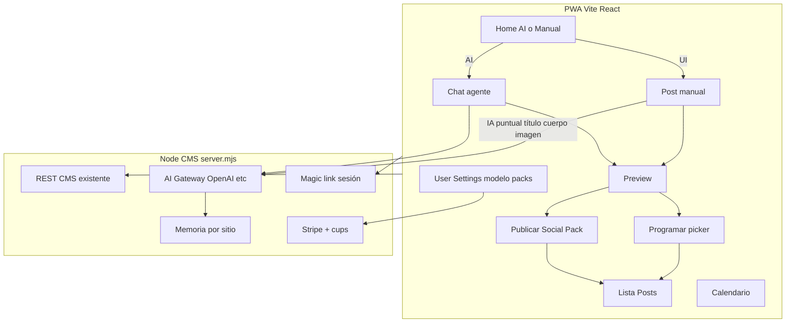

# PWA Escarlet CMS (agente in-app)

Plan de reestructuración. Rama propuesta: `feature/pwa-agent` desde `master`.

**Resumen.** Nueva PWA Vite+React mobile-first (shell tipo ChatGPT), gateway IA en el CMS Node existente, flujos duales AI/manual hasta preview → publicar/programar, billing Stripe y admin interno. El MCP externo comparte los mismos flujos y operaciones server-side.

## Checklist

- [x] Rama `feature/pwa-agent` + scaffold Vite React TS PWA y servir dist desde `server.mjs`
- [x] Login magic link + shell ChatGPT (home AI/manual, posts, calendario, user menu)
- [x] Flujo post manual mobile-first → preview → publicar/programar (sin nav Medios)
- [x] `lib/ai-gateway.mjs` OpenAI + streaming + cups + memoria por sitio
- [x] Chat agente con tools CMS y vuelta a preview/edición
- [x] Pantallas Social Pack y schedule picker post-preview
- [x] Admin: brand kit, sitios, settings, usuarios magic link
- [x] UI packs Stripe + selector modelo + gates de uso

## Decisiones cerradas

- **Producto:** PWA instalable + MCP externo. La conexión ChatGPT usa `POST /mcp` y las mismas operaciones server-side; `/app` es la superficie de revisión humana.
- **Frontend:** **Vite + React + TypeScript** en `apps/pwa/`, servido por el CMS en producción. El backend sigue siendo [`server.mjs`](../server.mjs) + `lib/*` (APIs, brand kit, publish, Stripe). Evitamos Next fullstack en esta fase para no reescribir ops/sync/webhook.
- **Auth cliente:** magic link (Resend) + sesión cookie. Sin “Login with ChatGPT”. Las keys de OpenAI/Gemini/Grok son **del servidor Escarlet**, no del usuario final.
- **Medios:** sin nav “Medios” para el cliente. Los ficheros viven **dentro del post** (y social pack del post). Admin puede reutilizar helpers existentes de media sin exponer biblioteca como producto.
- **Rama:** `feature/pwa-agent` desde `master`.

## Arquitectura

## IA de producto (dos perfiles)

**Cliente (no técnico)** — menú mínimo estilo ChatGPT:

- Home: elegir **AI** o **crear post manual**
- Chat con historial de conversaciones/posts
- Preview → Publicar (social pack) o Programar (datepicker) → Lista Posts
- Calendario
- Menú usuario (abajo izq.): settings, selector de modelo, packs/créditos, logout

**Admin Escarlet** — mismas pantallas de posts + capas ops:

- Brand kit, sitios/páginas, settings (deploy WP/plugin, claves sistema)
- Usuarios + magic link / reenvio
- Posts (listado + regenerar social pack vía API)
- Calendario
- Sin biblioteca de medios como producto

## Flujos UX (pizarras)

1. **AI:** Home → Chat (agente con brand kit + memoria del sitio) → Preview → Prog. o Publicar → Posts. Desde Preview se puede volver al chat a iterar.
2. **Manual:** Home → Post form mobile-first (campos apilados, ancho contenido acotado en desktop) → botones IA puntuales (“título”, “cuerpo”, “imagen”) → mismo Preview/Prog/Publicar.
3. **Settings:** modelo (free / GPT / Gemini / Grok según plan), packs Stripe, conexión sitio (Connect W) solo admin.

## Backend a extender (reutilizar)

| Capacidad | Base actual | Nuevo |
| --- | --- | --- |
| Posts CRUD, schedule, publish, social pack | [`lib/cms-ops.mjs`](../lib/cms-ops.mjs), [`lib/post-utils.mjs`](../lib/post-utils.mjs) | Endpoints limpios para la PWA; simplificar wizard 3 pasos |
| Brand kit | [`lib/brand-kit.mjs`](../lib/brand-kit.mjs) | Inyectar en system prompt del agente |
| Planes / cups | [`lib/plans.mjs`](../lib/plans.mjs) | Contar tokens/generaciones del gateway; bloquear si cupo 0 |
| Stripe | [`lib/stripe-webhook.mjs`](../lib/stripe-webhook.mjs) | Checkout/portal cliente + catálogo packs (uso + bundles) |
| Magic link | [`lib/access-tokens.mjs`](../lib/access-tokens.mjs), [`lib/magic-email.mjs`](../lib/magic-email.mjs) | Login PWA por defecto; password opcional admin |
| MCP | [`mcp/`](../mcp/) | Herramientas de workflow `/app`, generación server-side y publicación |

**Nuevo módulo:** `lib/ai-gateway.mjs`

- Proxies a OpenAI (primero); stubs Gemini/Grok detrás de feature.
- Tools internas equivalentes a las ops del CMS (crear/actualizar draft, validar SEO, adjuntar media, proponer social pack) **sin** exponer MCP al usuario.
- Streaming SSE hacia la PWA.
- Memoria por `site`: resumen + hechos en `data/memory/{handle}.json` (o tabla si ya hay PG); se actualiza tras cada conversación cerrada/publicación.
- Meter uso en `db.usage` y entitlements del sitio.

## Frontend PWA (`apps/pwa`)

- Vite + React + TS, React Router, CSS variables (design system propio, mobile-first).
- `vite-plugin-pwa`: manifest + service worker (shell offline; API online).
- Layout ChatGPT-like: sidebar conversaciones/posts, área chat, user footer.
- Pantallas: Home, Chat, ManualPost, Preview, Schedule, PublishSocial, Posts, Calendar, Settings, Billing, Admin (gated por rol).
- Dev: proxy a `localhost:3040`. Prod: `server.mjs` sirve `apps/pwa/dist` en `/` o `/app` y deja `/api/*` + sync runtime intactos.
- Admin HTML legacy ([`admin.html`](../admin.html) / [`public/admin.js`](../public/admin.js)): convive hasta migrar pantallas; luego redirect a la PWA.

## Billing (Stripe)

- Packs: pay-as-you-go y bundles con límite de tokens/posts.
- Modelo elegido en Settings → precio/multiplicador según proveedor.
- UI “Créditos / Packs” + Customer Portal.
- Webhook existente actualiza `entitlements` / `usage`.

## Fases en la rama

### Fase 0 — Repo y shell

Crear rama, scaffold `apps/pwa`, servir dist desde `server.mjs`, login magic link, nav mínima Posts/Calendario/User.

### Fase 1 — Post manual simplificado

Sustituir wizard 3 pasos por un formulario único mobile-first → Preview → Publicar/Programar → lista. IA puntual (título/cuerpo/imagen) vía gateway.

### Fase 2 — Agente in-app

Chat + tools CMS + memoria por sitio + selector modelo. Preview compartido con el flujo manual.

### Fase 3 — Social pack + schedule UX

Pantallas post-preview según pizarra; regenerar social pack desde detalle de post (admin y cliente con permiso).

### Fase 4 — Admin + usuarios

Brand kit, sitios, settings deploy/WP, usuarios + magic link resend. Ocultar Medios del producto.

### Fase 5 — Stripe packs

Catálogo, checkout, portal, gates en gateway y publicación.

### Fase 6 — PWA polish

Instalable, safe areas, desktop max-width en formularios, quitar/redirect admin legacy cuando paridad OK.

## Criterios de éxito (cliente)

- Crear un post por AI o manual en pocos pasos, sin biblioteca de medios ni jerga MCP.
- Entender Preview → Publicar o Programar.
- Ver posts y calendario.
- Cambiar modelo y comprar créditos sin salir de la app.
- Admin Escarlet gestiona sitios, brand, usuarios y settings sin que el cliente vea esa complejidad.

## Fuera de alcance (esta rama)

- Migración Payload/Postgres completa.
- Self-serve alta de clientes públicos (sigue siendo servicio Escarlet).
- Next.js fullstack (revisable solo si la PWA Vite se queda corta en routing/SSR).
